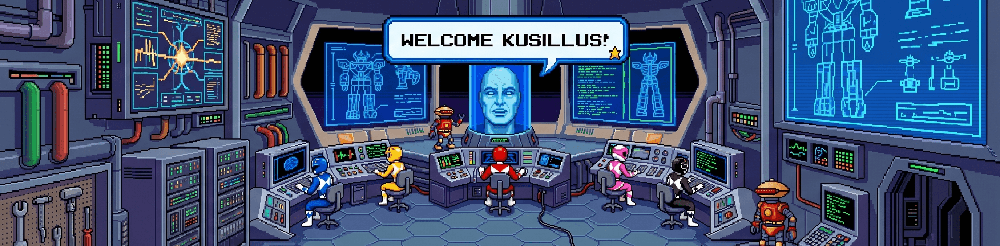
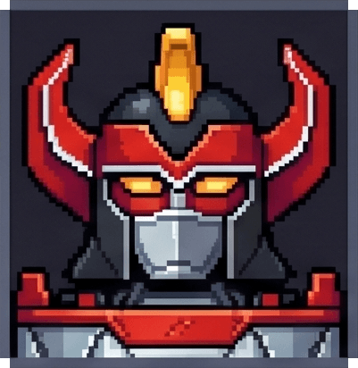
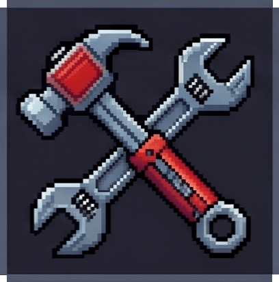

[](assets/banner.png)

# Hola, soy Alexander (kusillus) 👋

### Tech Lead en CambioSeguro · Experimentando con IA · Entrenador Pokémon ⚡

Hago software desde hace más de 7 años y sigo con la misma curiosidad del primer día. Hoy lidero el equipo técnico de [CambioSeguro](https://cambioseguro.com), y en mis ratos libres pruebo cuanta herramienta nueva sale, sobre todo si tiene que ver con IA.

[](https://github.com/kusillus) [](https://www.tiktok.com/@kusillus) [](https://linkedin.com/in/kusillus)

---

###  Sobre mí

- **Ahora mismo:** Tech Lead en CambioSeguro, enfocado ahí al 100%. Diseño APIs, cuido la arquitectura y me aseguro de que lo que sale a producción siga funcionando después.
- **Lo que estoy explorando:** cómo meter la IA en el día a día del desarrollo. Uso Claude Code, Claude API, AWS Bedrock, Ollama y Gemini, y los conecto con nuestras herramientas mediante servidores MCP.
- **Mi entorno:** me muevo entre Linux y Windows. En el trabajo uso Linux Mint. Para mis proyectos personales uso Windows 11 con WSL2, ajustado para que no se coma los recursos, porque ahí corren mis herramientas de diseño y edición. Pero donde más disfruto es en Linux, porque puedo personalizar hasta el último detalle.

---

###  Con qué trabajo

| Área               | Tecnologías                                                  |
| :----------------- | :----------------------------------------------------------- |
| **Backend**        | Node.js · Koa · Express · TypeScript · JavaScript            |
| **Bases de datos** | MongoDB · PostgreSQL · MySQL · DynamoDB                      |
| **Frontend**       | Nuxt · Vue · React · TailwindCSS · Bootstrap                 |
| **Infra**          | AWS (Bedrock, WAF, CDK, CodePipeline) · Docker · LocalStack  |
| **IA**             | Claude Code · ChatGPT · Gemini CLI · DeepSeek · Ollama · MCP |
| **Sistema**        | Linux Mint · CachyOS · Arch Linux · Windows 11 + WSL2        |

---

###  Fuera del código

- 🖨️ **Impresión 3D:** tengo una Ender 3 V2 (FDM) y una LD-002H (resina). Imprimo cosas para todo tipo de usos, sobre todo piezas y accesorios para mis otros hobbies.
- 🎥 **GoPro:** salgo a grabar lo que me llama la atención y lo convierto en videos para mis redes.
- 🎮 **Juegos:** de mesa, de cartas y videojuegos. Si hay partida, me apunto.
- 📺 **Anime y series:** Megaman, Pokémon, Power Rangers, Macross y Evangelion.
- 🎸 **Música:** escucho de todo, pero casi siempre suena rock, metal o música japonesa.
- 🏋️ **Gym:** voy seguido y trato de llevar una vida sana.
- 🐈 **En casa:** mi esposa y nuestros 6 gatos, que hacen QA de cada despliegue caminando sobre el teclado.

---

###  Conversemos

Si quieres hablar de fintech, IA, Linux o de cuál es el mejor final de Evangelion, escríbeme.

- 🌐 **Web:** [kusillus.dev](https://kusillus.dev)
- 💼 **LinkedIn:** [linkedin.com/in/kusillus](https://linkedin.com/in/kusillus)
- ✉️ **Email:** wguevarab7@gmail.com

```js
const kusillus = {
  rol: "Tech Lead @ CambioSeguro",
  stack: ["Node.js", "MongoDB", "AWS", "Nuxt"],
  explorando: ["IA", "MCP", "lo que salga esta semana"],
  playlist: ["rock", "metal", "música japonesa"],
  gatos: 6,
};
```
